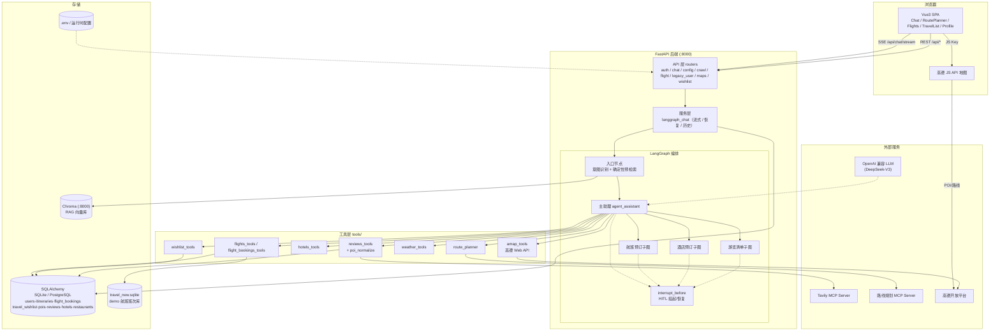
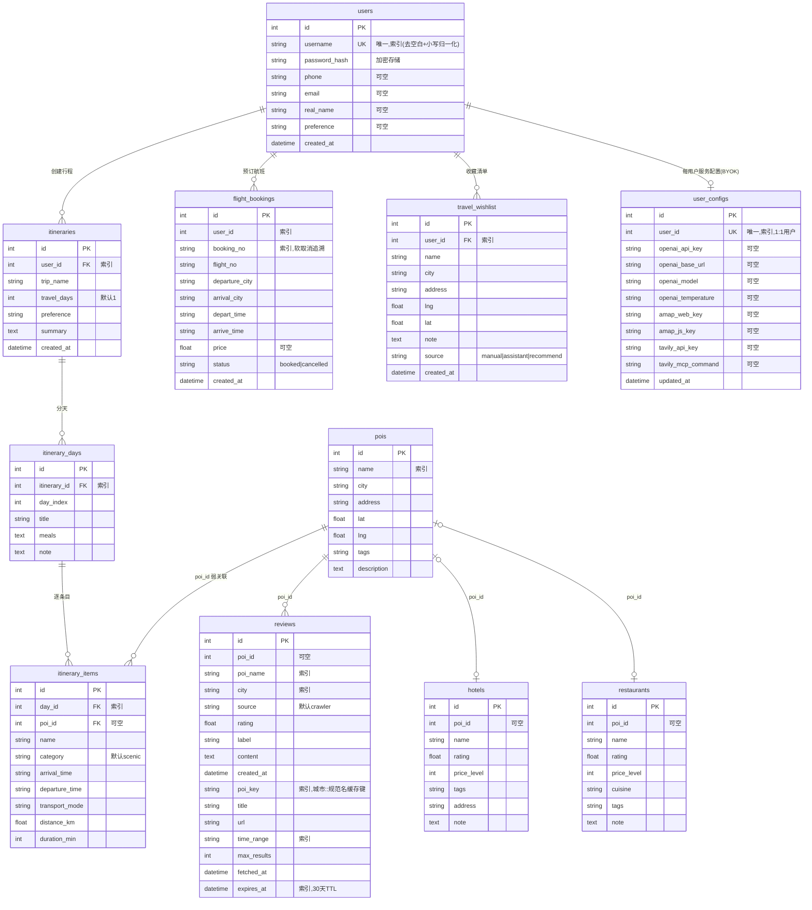

# PRD 需求分析 —— 智能多景点旅行规划 Agent 系统

> 版本：v1.0 ｜ 状态：初稿
> 需求来源：《需求清单.md》（FR 编号本文直接引用）
> 本文所有内容均对照项目代码事实（`app/`（含 `app/graph_chat/`）、`tools/`、`frontend/src/`）编写，标注【事实】的部分可在代码中直接验证。

## 修订记录

| 版本 | 日期 | 变更说明 |
| --- | --- | --- |
| v1.0 | 2026-10-18 | 初稿：基于现有实现反推并规范化 |
| v1.1 | 2026-11-03 | 服务配置改为每用户独立（BYOK，新增 `user_configs` 表）；会话历史按 `user_id` 命名空间隔离；注册用户名去空白+小写归一化 |

---

## 1. 业务背景

传统旅行规划的四大痛点：

1. **信息分散**：景点、酒店、航班、路线分布于多个平台，用户自行比对拼接成本高；
2. **行程编排复杂**：多景点游览涉及地理顺序、营业时间、交通耗时的组合优化，人工规划困难；
3. **通用 LLM 幻觉**：大模型对景点评价、实时攻略等时效性信息凭记忆编造，不可信；
4. **工具无闭环**：既有工具只能"查询"，无法在对话内完成"预订 / 取消"等写操作并保证安全。

本项目以 **LangGraph 多 Agent 编排**为核心，构建"规划 — 推荐 — 检索 — 预订"对话式闭环的旅行规划系统。

## 2. 业务目标与成功指标

| 目标 | 成功指标 |
| --- | --- |
| 对话闭环 | 单一会话内完成行程生成 → POI/酒店推荐 → 评价查询 → 航班预订 |
| 反幻觉 | 评价类问题 100% 走确定性预检索（DB → Tavily → 写库），回答可溯源（title / url） |
| 写操作安全 | 预订 / 改签 / 取消 100% 经 HITL 二次确认后写库 |
| 体验 | SSE 流式输出，首字秒级；敏感确认框断线后可恢复（`/chat/pending`） |
| 部署 | `docker compose up --build` 一键起后端(8000) / 前端(3000) / Chroma(容器内 8000)；对外仅暴露前端 3000 |

## 3. 用户与角色

| 角色 | 说明 |
| --- | --- |
| 游客 | 仅可访问登录 / 注册页 |
| 注册用户 | 基础业务角色，全部业务功能（服务配置为**每用户独立 BYOK**：自填自己的 Key，未填回退 `.env` 默认）；数据与配置均按 `user_id` 隔离【事实：chat 接口服务端解析令牌取 `user_id`，忽略前端身份字段防越权；配置存 `user_configs` 表】 |
| 部署者 | 不进系统，通过 `.env` / Docker Compose 管理 |

前端路由守卫：`requiresAuth` 页面先查本地 token，再调 `authApi.me()` 校验真实性；401 时 axios 拦截器用 refresh token 静默续期【事实：`frontend/src/router/index.js`】。

## 4. 功能需求

按《需求清单.md》第 6 节的 FR 编号执行，此处给出开发视角的补充规则。

### 4.1 用户与认证（FR-A）
- 注册：用户名唯一（去首尾空白并统一小写后比较，大小写不敏感），冲突返回 409"用户名已存在"；密码经 `hash_password` 加密存储，不落明文【事实：`app/api/routers/auth.py`】
- 登录：返回 `access_token` + `refresh_token` + 用户信息；JWT `sub` 格式为 `{id}:{username}`
- 续期：`POST /api/auth/refresh` 校验 refresh 令牌类型后换发新双令牌
- 用户档案字段：username、password_hash、phone、email、real_name、preference、created_at

### 4.2 智能对话（FR-B）—— 系统核心
对话链路【事实：`app/graph_chat/entry_node.py`、`app/services/langgraph_chat.py`、README 架构图】：

```text
用户消息
  │
  ▼
入口节点：意图识别 ──评价/攻略类──► 确定性预检索：DB(30天缓存) → Tavily → 回写库 → 材料注入上下文
  │
  ▼
LangGraph 主助理（agent_assistant）
  ├── bind_tools 工具调用：POI / 路线 / 航班 / 酒店 / 评价 / 天气 / 清单
  ├── 子图委托：航班预订 / 酒店预订 / 游览清单（build_child_graph）
  │     └── CompleteOrEscalate：子 Agent 交还主助理（响应含 escalated / handoff）
  └── 敏感操作：interrupt_before 挂起 → 前端确认框 → /chat/resume(approved) → 写库
  │
  ▼
SSE 流式输出（text/event-stream，X-Accel-Buffering: no）
```

关键规则：
- 会话以 `session_id` 经 Checkpointer 持久化，刷新页面后 `/chat/history/{session_id}` 恢复，`/chat/pending` 恢复未完成的确认框；会话定位（thread_id / 历史文件 / 审批台账）按 `user_id` 命名空间隔离（`{user_id}:{session_id}`），读取接口服务端解析令牌取 `user_id` 定位，杜绝跨用户读会话【事实：`app/services/langgraph_chat.py` 的 `_scoped_session_id`】；
- 航班卡片"加入我的航班"与对话内预订共用同一确认机制：先挂起（不写库），确认后 resume 才写【事实：`chat_book_flight` 注释】。

### 4.3 行程规划（FR-C）
- 输入：目的地、天数、偏好；输出：分天行程（每日 title / 用餐 / 备注 + 各时段条目）；
- 条目含：名称、类别（默认 scenic）、到达 / 离开时间、交通方式、距离 km、耗时 min；
- 行程持久化为三级结构：`itineraries → itinerary_days → itinerary_items`（`itinerary_items.poi_id` 弱关联 `pois.id`）。

### 4.4 地图与路线（FR-D）
- 能力：POI 搜索、地理编码 / 坐标转换（`location_trans.py`）、路线规划；
- 路线规划双通道：内部 Python 工具（`route_planner.py`）+ 独立 MCP Server（`mcp_route_server.py` / `mcp_route_client.py`），可被 Claude Desktop / Cursor 等外部 Agent 复用；
- POI 名称归一化（`poi_normalize.py`）统一同义景点名，同时服务于地图搜索与评价缓存键。

### 4.5 航班（FR-E）
- 班次库与业务库物理分离【事实：`app/models/flight.py` 注释】：班次在 demo 库 `travel_new.sqlite`（可整体重置 / 日期平移），预订单在业务库 `flight_bookings`；
- 预订单状态机：`booked → cancelled`（软取消，保留 `booking_no` 便于追溯，不删数据）；
- 敏感操作（预订 / 改签 / 取消）一律 HITL。

### 4.6 评价 / 攻略检索（FR-G）—— 反幻觉关键
【事实：`app/models/review.py`、`tools/reviews_tools.py`】

```text
查询"XX景点怎么样"
  → 归一化 poi_key = 城市::规范景点名（"小珠山"/"珠山国家森林公园" 命中同一缓存）
  → 查 reviews 表：expires_at 未过期 → 直接返回缓存
  → 过期/未命中 → Tavily MCP 联网检索（REVIEW_CACHE_TTL_DAYS=30）
  → 结果回写 reviews（poi_key / title / url / fetched_at / expires_at）
  → 材料注入上下文，回答附来源
```

## 5. 人工校验与修正的业务逻辑

以下逻辑在实现评审中经过人工校验 / 修正，为本 PRD 确认的**权威业务规则**：

| 编号 | 业务规则 | 校验结论 |
| --- | --- | --- |
| V-1 | 评价类问题**禁止**直接让 LLM 凭记忆回答 | 必须先走确定性预检索；未命中联网则明确告知无实时数据 |
| V-2 | 评价缓存有效期 30 天（`REVIEW_CACHE_TTL_DAYS`），按 `poi_key` 判定 | 同义景点名必须归一化后命中同一缓存，否则缓存被重复击穿 |
| V-3 | 敏感写操作**不允许**在首次请求内直接写库 | 必须两段式：挂起 → 确认 → resume 写库；同步适用于卡片入口 |
| V-4 | 取消订单采用软删除 | 保留记录与 `booking_no`，满足追溯需求，不做物理删除 |
| V-5 | demo 班次库与业务库必须隔离 | 防止预订单写入被班次重置 / 日期平移覆盖 |
| V-6 | 用户身份以服务端 JWT 为准 | 前端传入的任何 `user_id` 字段一律忽略，防止水平越权 |
| V-7 | TSP 优化在地理顺序优化时须兼顾时间窗 | 纯距离最优可能违反营业时间 / 到达离开时间约束，需联合权衡 |
| V-8 | SSE 必须关闭反代缓冲 | 否则 nginx 缓冲导致前端长时间零字节超时 |
| V-9 | 会话必须按 `user_id` 命名空间隔离 | 会话定位（thread_id / 历史文件 / 审批台账）不得使用裸 `session_id`，需前缀 `user_id`；读取接口按令牌解析 `user_id` 定位，防止跨用户读历史 |

## 6. 架构方案与选型

### 6.1 选型决策

| 层 | 选型 | 备选 | 决策理由 |
| --- | --- | --- | --- |
| Agent 编排 | LangGraph | AutoGen / 自研状态机 | 原生支持图状态机、Checkpointer 会话持久化、`interrupt_before` HITL、子图嵌套——与本项目 HITL + 会话恢复需求精确匹配 |
| LLM | OpenAI 兼容协议（DeepSeek-V3 / SiliconFlow 默认） | 绑定单一供应商 | 兼容协议可随时切换供应商，配合运行时配置热切换 |
| 后端 | FastAPI + Uvicorn | Flask / Django | 原生 async（SSE 必需）、Pydantic 校验、自动 Swagger |
| 向量库 | Chroma | Milvus / pgvector | 轻量本地持久化，适合单机部署；Docker 服务化（容器内 8000） |
| 联网检索 | Tavily MCP | 直接 HTTP 调 Tavily / SearxNG | MCP 标准化协议，同一工具可被外部 Agent 复用 |
| 地图 | 高德 Web API + JS API | 百度 / 腾讯地图 | 国内 POI 数据与路径规划质量最优 |
| 前端 | Vue3 + Vite + Element Plus + Pinia | React | 组合成熟、组件库覆盖表单 / 对话 / 地图场景 |
| 数据库 | SQLAlchemy（SQLite → PostgreSQL 可切） | 裸 SQL | ORM 屏蔽方言，开发期零运维，生产可平滑升级 |
| 部署 | Docker Compose | K8s | 单机学习 / 演示场景，Compose 已覆盖三服务编排 |

### 6.2 系统架构图



## 7. 模块划分

### 7.1 后端（app/）
| 模块 | 路径 | 职责 |
| --- | --- | --- |
| API 层 | `app/api/routers/` | 8 个路由：auth、chat、config、crawl、flight、legacy_user、maps、wishlist（graph、plan、poi 路由在清理第二套规划实现后已不存在） |
| 鉴权依赖 | `app/api/deps.py` | `get_current_user`：解析 JWT，注入 user_id |
| 配置 | `app/core/`、`app/services/` | 静态 config + 运行时 runtime_config（`.env` 兜底）+ `user_config`（每用户 BYOK 配置，存 `user_configs` 表） |
| 服务层 | `app/services/` | langgraph_chat（流式、resume、pending、history）、调度、知识库 |
| 编排 | `app/graph_chat/` | 入口节点、主助理、子图构建、状态定义、LLM 配置、日志 |
| 模型 | `app/models/` | 10 个 ORM 模型（见第 9 节 ER） |
| 校验 | `app/schemas/` | Pydantic 请求 / 响应模型 |
| 持久化 | `app/db/` | 会话管理与初始化 |

### 7.2 工具层（tools/）
| 工具 | 职责 |
| --- | --- |
| `amap_tools` | 高德 POI / 地理编码 / 路线 |
| `flights_tools` / `flight_bookings_tools` | 班次查询 / 预订单写操作（分离） |
| `hotels_tools` / `weather_tools` / `wishlist_tools` | 酒店 / 天气 / 清单工具 |
| `reviews_tools` + `poi_normalize` | 评价检索 + 30 天缓存 + 名称归一化 |
| `route_planner` + `mcp_route_server/client` | 路线规划（内部工具 + MCP 双通道） |
| `mcp_tavily_client` | Tavily MCP 客户端 |
| `retriever_vector` | Chroma 向量检索 |
| `location_trans` / `poi_normalize` / `init_db` | 坐标转换 / 名称归一化 / demo 库初始化 |

### 7.3 前端（frontend/src/views/，7 页面）
见第 8 节页面原型描述。

## 8. 页面原型描述

| 页面 | 路由 | 原型描述 |
| --- | --- | --- |
| 登录页 | `/login` | 用户名 + 密码表单，登录成功存 token / refreshToken / userInfo 后跳 `/route-planner`；已登录访问自动重定向 |
| 注册页 | `/register` | 用户名、密码，可附手机号 / 邮箱 / 真名 / 偏好；成功后引导登录 |
| 地图规划页 | `/route-planner` | **默认首页**（36KB 最重组件）：高德 JS 地图 + 搜索面板 + 途经点管理 + 路线结果面板；支持实时路线规划与 TSP 顺序优化展示 |
| 智能对话页 | `/chat` | 对话主界面：消息流（SSE 渲染）+ 结构化卡片（航班卡片带"加入我的航班"、评价卡片带 title/url 来源、酒店/POI 卡片）+ HITL 确认框 + 会话历史侧栏 |
| 航班页 | `/flights` | 班次查询 + "我的航班"（按用户隔离的 `flight_bookings`，区分 booked / cancelled） |
| 旅行清单页 | `/travel-list` | 清单列表（名称 / 城市 / 地址 / 备注 / 来源标签），支持手动添加、删除 |
| 个人配置页 | `/profile` | 用户信息展示 + 「服务配置」区（每用户独立 BYOK）：LLM Key/BaseURL/模型/Temperature、高德 Key、Tavily Key；保存即写入 `user_configs` 表、仅对自己生效；未填写项沿用服务器 `.env` 默认值 |

页面流转：`/` → (有 token) → `/route-planner`；(无 token) → `/login`。全部业务页受 `requiresAuth` 守卫。

## 9. 接口需求

### 9.1 内部 API（前缀 `/api`，全部经 JWT 鉴权除 auth/register、auth/login、refresh、health、docs）

| 接口 | 方法 | 说明 | 对应需求 |
| --- | --- | --- | --- |
| `/api/auth/register` | POST | 注册（409 重名） | FR-A1 |
| `/api/auth/login` | POST | 登录，返回双令牌 | FR-A2 |
| `/api/auth/refresh` | POST | 刷新令牌 | FR-A3 |
| `/api/auth/me` | GET | 当前用户 | FR-A4 |
| `/api/chat` | POST | 同步对话 | FR-B8 |
| `/api/chat/stream` | POST | SSE 流式对话 | FR-B1 |
| `/api/chat/resume` | POST | HITL 恢复（approved: bool） | FR-B5 |
| `/api/chat/book-flight` | POST | 航班卡片发起预订（挂起不写库） | FR-B7 |
| `/api/chat/pending` | GET | 查询会话中断态 | FR-B6 |
| `/api/chat/history/{session_id}` | GET | 会话历史恢复 | FR-B6 |
| `/api/travel/plan`（已移除） | POST | 行程规划改由对话式 Agent（`/api/chat/stream`）提供；该独立 REST 接口已随第二套规划实现移除 | FR-C1 |
| `/api/maps/poi` | GET | POI 搜索 | FR-D1 |
| `/api/maps/route` | POST | 路线规划 | FR-D2 |
| `/api/flight/*` | — | 航班查询 / 我的航班 | FR-E1/E3 |
| `/api/wishlist/*` | — | 清单增删查 | FR-H1 |
| `/api/config/runtime` | GET/POST | 当前登录用户自己的运行时配置（BYOK，未填写回退 `.env`） | FR-I1/I2 |
| `/api/crawl` | POST | 数据同步（预留） | FR-J3 |
| `/health` | GET | 健康检查 | FR-J1 |

### 9.2 外部依赖

| 依赖 | 用途 | 失效降级 |
| --- | --- | --- |
| OpenAI 兼容 LLM | 推理核心 | **硬依赖**，未配置则核心功能不可用（每用户可在配置页自填，未填回退 `.env`） |
| 高德 Web API | POI / 路线 | 工具报错，Agent 提示用户 |
| 高德 JS API | 前端地图渲染 | 地图页降级为列表 |
| Tavily MCP | 联网检索 | 回退本地缓存，未命中则告知无实时数据 |
| Chroma | RAG 检索 | 降级为纯工具调用 |

## 10. 数据库 ER 图

【事实：`app/models/` 下 10 个模型；另有独立 demo 库 `travel_new.sqlite` 存航班班次，不在此 ER 内】



存储分工：
- **业务库**（SQLAlchemy：SQLite / PostgreSQL）：上表全部实体；
- **demo 班次库** `travel_new.sqlite`：航班班次（只读查询源，可重置 / 日期平移）；
- **向量库** Chroma：政策 FAQ + POI / 评论知识集合（RAG）；
- **缓存键**：`reviews.poi_key` + `expires_at` 构成 30 天评价缓存。

## 11. 可扩展性评估

| 维度 | 现状 | 扩展路径 | 评估 |
| --- | --- | --- | --- |
| LLM 供应商 | OpenAI 兼容协议 + 运行时配置 | 换 Key / BaseURL 即切换；每用户可自填自己的 Key（BYOK）热生效 | ★★★★★ |
| Agent 能力 | 子图经 `build_child_graph` 组装，工具经 `bind_tools` 动态绑定 | 新增领域（如火车票、签证）= 新增子图 + 工具文件，不改主链路 | ★★★★☆ |
| 工具协议 | 路线规划 / 网页搜索已 MCP 化 | 新工具以 MCP Server 暴露即可被 Claude Desktop / Cursor 复用 | ★★★★☆ |
| 数据库 | SQLAlchemy ORM 屏蔽方言 | SQLite → PostgreSQL 仅改 `DATABASE_URL` | ★★★★☆ |
| 知识库 | Chroma 集合按类别组织，支持增量补充 | 按目的地扩展集合；`/api/crawl` 预留自动同步入口 | ★★★☆☆ |
| 水平扩展 | 会话态依赖 Checkpointer（本地） | 需将会话存储迁至 Redis / PostgreSQL；SSE 需粘性会话或网关 | ★★☆☆☆（单机当前够用） |
| 多租户 | 无完整角色/组织模型（仅 `ADMIN_USERNAMES` 轻量管理员判定）；已实现每用户独立配置（`user_configs` 表，BYOK） | 需加角色表与数据权限层，改动面较大 | ★★☆☆☆（明确范围外） |

**结论**：能力扩展性（Agent / 工具 / 供应商）强，符合项目"Agent 工程范式演示"定位；规模化扩展（多机 / 多租户）非当前目标，已列入范围外。

## 12. 非功能性指标评审

### 12.1 性能
| 指标 | 目标 | 现状依据 |
| --- | --- | --- |
| 对话首字延迟 | 秒级 | SSE 节点级流式推送，边跑图边发事件，避免整图跑完再返回 |
| 长任务体验 | 不超时 | `X-Accel-Buffering: no` 关闭反代缓冲；节点事件保活 |
| 评价查询延迟 | 缓存命中毫秒级 | `poi_key` + `expires_at` 索引直查；30 天 TTL 减少外网调用 |
| POI / 路线延迟 | 受高德 API 约束 | 依赖缓存与并发控制 |

**风险**：LLM 推理延迟为最大变量（秒级~十秒级），已通过流式与预检索前置缓解；未做接口限流，依赖 Tavily / 高德自身配额，建议后续加限流中间件（P2）。

### 12.2 可用性
| 指标 | 目标 | 现状依据 |
| --- | --- | --- |
| 部署可用性 | 一键起三服务 | Docker Compose：前端 3000 为对外入口；后端 8000 / Chroma 8000 / MCP 8001 仅容器内网（`expose`） |
| 健康检查 | `GET /health` | 已实现 |
| 会话可恢复 | 刷新不丢对话 | Checkpointer 持久化 + `/chat/history` + `/chat/pending` 恢复中断态；会话按 `user_id` 命名空间隔离，仅本人可恢复 |
| 优雅降级 | 单一外部依赖失效不整体不可用 | Tavily 失效→本地缓存；高德失效→Agent 提示；LLM 为硬依赖不可降级 |
| 数据持久 | 容器重建不丢数据 | 数据库与向量库目录被 `.gitignore` 持久化挂载 |

**风险**：单机部署无冗余，LLM 子进程（MCP）崩溃需依赖重试；后端无自动重启外的故障转移——符合学习 / 演示定位，生产化需 K8s + 多副本（范围外）。

### 12.3 安全性（关联需求清单 R-9）
- 密码 `hash_password` 加密存储，不落明文；
- JWT access + refresh 双令牌，refresh 可静默续期；
- 服务端解析 `user_id`，忽略前端身份字段，防水平越权；
- 敏感写操作 HITL 强制确认；软取消保留审计痕迹（`booking_no`）；
- Key 服务端持久化（`.env` 默认 + 每用户 `user_configs` 表）；前端配置页按 `user_id` 隔离读写，用户只能查看/覆盖自己的 Key，敏感字段脱敏展示。

### 12.4 可维护性 / 可测试性
- 分层清晰：api / services / graph / tools / models / schemas；
- `pytest -q tests`（tests/）覆盖核心链路；
- Swagger `/docs` 自动生成接口文档。

## 13. 风险

详见《需求清单.md》第 5 节（R-1 ~ R-9），PRD 层面需重点跟踪：R-1（幻觉）、R-3（敏感操作）、R-4（SSE 缓冲）。

## 14. 验收标准

1. 注册 / 登录 / 刷新 / 鉴权全流程可用，重名返回 409（用户名去空白+小写归一化）；
2. 对话流式输出正常，评价类问题回答带来源（title / url），无凭空编造；
3. 航班预订 / 改签 / 取消必须出现确认框，确认前不写库；取消后订单仍可查（软取消）；
4. 刷新页面后对话历史与未完成确认框可恢复；
5. 行程规划产出分天行程，含时间 / 交通 / 距离字段，顺序经 TSP 优化；
6. 地图页 POI 搜索与路线可视化正常；
7. 清单三种来源（manual / assistant / recommend）均可入库并按用户隔离；
8. 运行时配置按用户保存后即时生效且重启持久（BYOK，未填写回退 `.env`）；
9. `docker compose up --build` 后三端可访问，数据目录持久；
10. `pytest -q tests` 全部通过。
